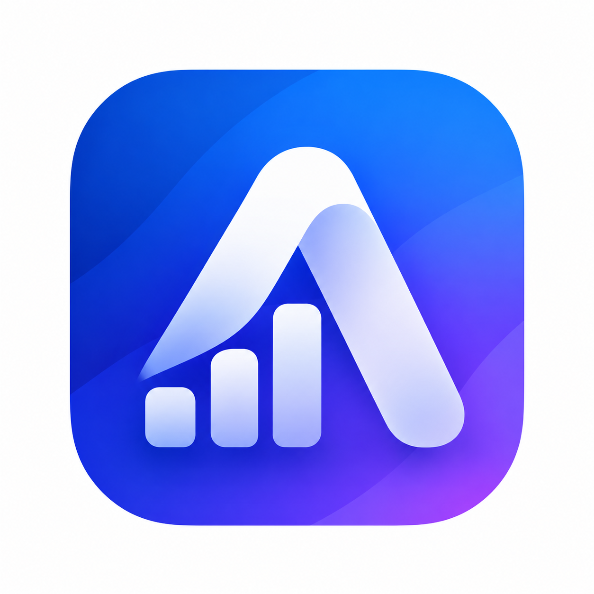

<p align="center">
  
</p>

<h1 align="center">AdSight</h1>
<p align="center"><strong>AI Assistant for Advertising Analytics</strong></p>
<p align="center">Connect advertising spreadsheets, compare metrics, and investigate performance changes.</p>

## Overview

AdSight is a web workspace for exploring advertising data from Lark spreadsheets. It uses NVIDIA API to suggest Korean column labels, meanings, and analysis roles, then applies settings after user review. Manual configuration is also available without AI.

**Current stage: a development MVP for data exploration and period comparisons.** Data retrieval uses Lark REST APIs, while dataset interpretation and explanations of detected changes use NVIDIA API. Conversational assistance and MCP-based agent workflows are planned.

## Features

### Data Connection and Settings

1. **Load a document** — Connect a Lark Sheets or Wiki document using its URL or token.
2. **Review the data** — Select a worksheet and preview original values. Optionally provide business context to guide AI interpretation.
3. **Configure columns** — Review and edit display names, roles, meanings, and recommendation rationale. Ambiguous AI recommendations require acknowledgement before application.

Each step can be collapsed and reopened. The source spreadsheet is accessed in read-only mode.

Approved settings are stored on the server using the resolved spreadsheet ID and worksheet ID. Reconnecting loads fresh data and offers to reuse those settings. Compatible settings can be reused as rows are added; changes to column structure, units, or formats require review. Uniquely named columns can be matched after reordering.

### Dashboard

- Apply target, date, and calculation filters to metric cards and charts together.
- Select a key metric card to view its daily trend and target comparisons. The first metric is displayed by default.
- Compare multiple metric trends in one chart and inspect target values in a sortable comparison matrix.
- Compare metrics with different units using percentage change from their first observation. Raw-value comparison is available when units match; percentage changes are not calculated from a zero baseline.
- Save the key metric cards, selected detail metric, and comparison metrics with the approved document settings. Comparison metrics initially use four eligible metrics and are subsequently managed independently of the key cards.

### Change Analysis

- Use filters **independent of the dashboard** to select a grouping column, targets, calculation method, two periods, and metrics.
- By default, compare the latest seven days against the preceding seven days, relative to the document's last data date. Choose each period through presets or calendars.
- Set separate increase and decrease thresholds, both defaulting to 5%. Each period needs at least three valid numeric observations to calculate a metric's percentage change.
- Card titles identify the calculation, such as an increase in the mean or a decrease in the sum. Percentage change is `(current value - previous value) / |previous value| × 100`. A zero baseline has no defined percentage change.
- Review missing dates, nonnumeric values, insufficient samples, and identical rows alongside metric changes. These are review rules, not statistical significance tests or proof of business causes.
- Browse result cards in two columns. Expanding a card shows the summary and AI explanation on the left and target-level visualizations on the right. Select a target name to view its daily trend.
- The first expansion requests a NVIDIA explanation. Results are reused within the current page for the same conditions. Long explanations scroll within their panel. Computed findings and visualizations remain available when AI is unavailable.

Analysis runs on demand against the loaded data. Scheduled checks, continuous monitoring, and notifications are not implemented.

### Feedback and Assistant

- Create, edit, delete, and resolve feedback items. Feedback is stored on the server and shared among users connected to that server.
- The AI assistant panel is marked **planned**. Sending conversational questions is not implemented.

## Architecture

```text
Lark Sheets / Wiki
       | Lark REST API · read-only
       v
FastAPI ---------- SQLite
       |           Approved settings · dashboard layouts · feedback
       +---------- NVIDIA API
       |           Column interpretation · finding explanations
       v
HTML / CSS / JavaScript
Data Connection -> Dashboard / Change Analysis / Feedback
```

| Layer | Technology |
| --- | --- |
| Backend | Python 3.11, FastAPI, HTTPX |
| Frontend | HTML, CSS, JavaScript, SVG charts |
| Data integration | Lark Sheets / Wiki REST APIs |
| AI | NVIDIA API with JSON Schema responses |
| Storage | SQLite; browser storage for recent documents |

## Getting Started

### 1. Set Up the Environment

```sh
git clone https://github.com/janghyunnoh/AdSight.git
cd AdSight
conda env create -f environment.yml
conda activate adsight
cp .env.example .env
```

Node.js is needed for JavaScript tests. Running the web server requires no separate frontend build.

### 2. Configure Environment Variables

Edit your local `.env` file. Keep real credentials out of source control.

```dotenv
LARK_APP_ID=your_app_id
LARK_APP_SECRET=your_app_secret
LARK_DOMAIN=https://open.larksuite.com

# Optional default document; automatic loading is disabled by default.
LARK_SPREADSHEET_TOKEN=
ADSIGHT_AUTOLOAD_DEFAULT=false

# Optional: required only for AI features.
NVIDIA_API_KEY=your_nvidia_api_key
NVIDIA_MODEL=nvidia/nemotron-3.5-lightning-30b-a3b

# Optional persistent database path for approved settings and feedback.
# ADSIGHT_NOTES_DB=/persistent/notes.sqlite3
```

The Lark app needs access to the target document and Sheets read permissions. Wiki links also require Wiki node read access. Publish an app version in the Lark Developer Console after changing permissions.

A separate `lark-openapi-mcp` checkout is not required to run the current web app. Ollama is not currently supported.

### 3. Start the Server

```sh
python -m uvicorn app.main:app --host 127.0.0.1 --port 8000 --reload --no-access-log
```

Open **http://127.0.0.1:8000** and connect a document. Restart the server after changing environment variables or backend configuration.

To open the workspace inside Lark, register the hosted URL as the Web App homepage. The web server must run separately.

## AI Behavior and Data Handling

- **Column interpretation:** Sends column names, up to ten randomly selected distinct sample values per column, numeric/date/unit format information, and optional user context. Fewer values are sent when fewer are available. Complete source rows are not sent.
- **Finding explanations:** Sends computed period values, percentage changes, sample counts, data-quality notices, and approved descriptions. Supporting evidence is limited to up to 30 daily aggregates per period, five target-level changes with the largest absolute differences, and three related metrics. Daily evidence for longer periods retains endpoints and extreme values.
- **Korean output:** User-facing explanations are requested in Korean. Prose fields without Korean text are rejected. Company names, original column names, and acronyms may retain their original form.
- **Failure handling:** Quota limits, timeouts, authentication failures, and invalid responses are reported without replacing computed results or approved settings. Requests are not automatically retried or sent to another provider.
- **Review:** AI recommendations about meaning, roles, and possible explanations are estimates. A change in a target's mean does not establish its contribution to the overall mean.

The default SQLite file is `data/notes.sqlite3`. Use persistent storage and backups when deploying. Recent documents are stored per browser, so Lark's embedded browser and a standalone browser may show different lists.

Authentication and per-user data isolation are not implemented. Lark app visibility and web server access control are separate. Restrict access to deployments that connect sensitive documents.

## Tests

Run regression tests without calling external APIs:

```sh
python -m unittest discover -s tests -q
```

```sh
for test_file in tests/test_*.cjs; do
  node "$test_file" || exit 1
done
```

Run a live NVIDIA connection check separately. This consumes API usage:

```sh
python -m scripts.verify_ai nvidia
```

## Implementation Status

- [x] Lark document connection, worksheet preview, and fresh data retrieval
- [x] NVIDIA column interpretation, Korean label suggestions, and user review
- [x] Approved settings and dashboard layout persistence
- [x] Key metrics and period/target comparison visualizations
- [x] Independent change-analysis filters and rule-based detection
- [x] Per-finding visualizations and NVIDIA explanations
- [x] Shared feedback and resolution tracking
- [ ] Conversational AI assistant
- [ ] Lark OpenAPI MCP-based agent workflows
- [ ] User authentication and access isolation
