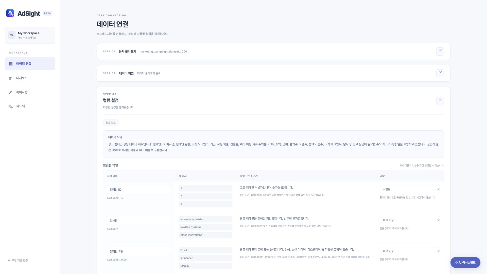
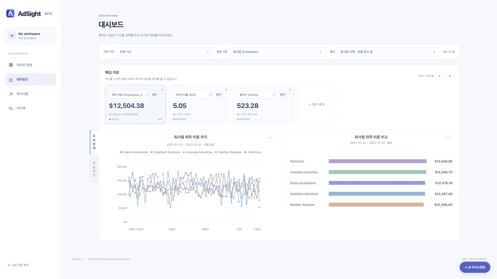
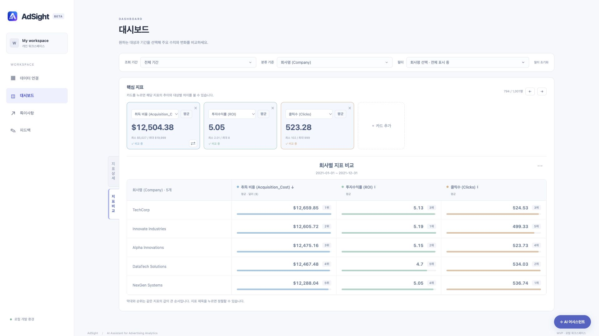
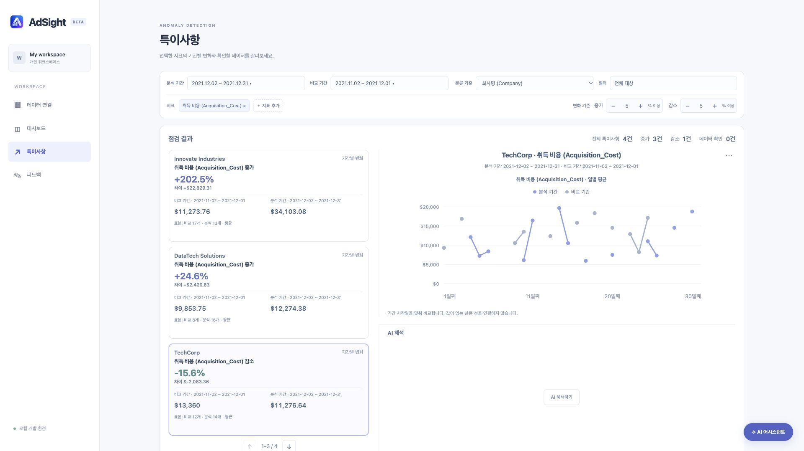

<p align="center">
  
</p>

<h1 align="center">AdSight</h1>
<p align="center"><strong>AI Assistant for Advertising Data Analytics</strong></p>
<p align="center">Connect advertising data, compare performance, and understand what changed.</p>

[Open AdSight](https://adsight.companionablegranola8.chatgpt.site) · Hosted access is limited to approved accounts.

## Overview

AdSight is a web-based advertising analytics workspace developed around marketing practitioners' feedback. It connects Lark spreadsheets, helps users configure their data with AI, and combines interactive dashboards with evidence-based change analysis.

The current MVP uses Lark REST APIs for read-only data access and NVIDIA API for column interpretation and finding explanations.

## Product walkthrough

**Connect & configure → Explore a metric → Compare metrics → Inspect changes with AI**

The screenshots use the same example dataset. Click any preview to open the full-size image.

### 1. Connect data and review column settings

Choose a Lark worksheet and review the AI-suggested column labels, roles, and currencies before applying them. Reuse approved settings when you reconnect.

<a href="docs/images/data-setup.jpg"></a>

### 2. Explore a metric in the dashboard

Choose a period, grouping, and targets, then select a metric card to see its trend and target-level values. Clicking a target bar highlights its corresponding trend without changing the query filters.

<a href="docs/images/dashboard.jpg"></a>

### 3. Compare multiple metrics across targets

Select the metrics to compare in one table. Column headings support sorting; values, bars, and ranks are interpreted **within the same metric**, rather than across different units.

<a href="docs/images/metric-comparison.jpg"></a>

### 4. Inspect changes and request an AI explanation

Set analysis and reference periods plus increase/decrease thresholds. Rule-based checks compare each target's metric averages and flag changes or insufficient data. Select a result to inspect the chart, then request an AI explanation of the evidence, limitations, and follow-up checks.

<a href="docs/images/anomaly-analysis.jpg"></a>

The preview shows a finding before AI explanation. Review AI suggestions against the displayed evidence.

Additional tools include original-currency/KRW display using daily reference exchange rates, visualization image copy/export, and shared feedback tracking.

## Tech Stack

| Layer | Technology |
| --- | --- |
| Backend | Python 3.11, FastAPI, HTTPX |
| Frontend | HTML, CSS, JavaScript, SVG |
| Data integration | Lark Sheets / Wiki REST APIs |
| AI | NVIDIA API with structured JSON responses |
| Persistence | SQLite |

## Getting Started

### 1. Set Up the Environment

```sh
git clone https://github.com/janghyunnoh/AdSight.git
cd AdSight
conda env create -f environment.yml
conda activate adsight
cp .env.example .env
```

### 2. Configure Credentials

Edit `.env` with your Lark app credentials and, optionally, an NVIDIA API key for AI features:

```dotenv
LARK_APP_ID=your_app_id
LARK_APP_SECRET=your_app_secret
LARK_DOMAIN=https://open.larksuite.com
NVIDIA_API_KEY=your_nvidia_api_key
NVIDIA_MODEL=nvidia/nemotron-3.5-lightning-30b-a3b
```

The Lark app needs Sheets read permissions and access to the target document. Wiki links also require Wiki node read access. Publish permission changes in the Lark Developer Console before testing.

See [.env.example](.env.example) for optional configuration.

### 3. Run the App

```sh
python -m uvicorn app.main:app --host 127.0.0.1 --port 8000 --reload --no-access-log
```

Open **http://127.0.0.1:8000** and connect a document. To access the workspace inside Lark, register your hosted URL as the Web App homepage.

## Data and AI

Source spreadsheets remain read-only. Approved settings, dashboard preferences, and feedback are stored in `data/notes.sqlite3`; use persistent storage when deploying.

Successful document connections are appended to a private `connection-history.txt` beside the database. Each entry contains the connection time, submitted document URL or token, resolved document ID, and title. Set `ADSIGHT_CONNECTION_LOG` to change the path. This file contains document identifiers and is excluded from source control.

AI interpretation uses column samples and optional user context. Finding explanations use computed aggregates and supporting evidence, rather than complete source rows. AI output is provided in Korean. Recommendations require review, and detected changes do not establish statistical significance or business causes. API failures preserve existing settings and computed results.

This is a development MVP with shared server data. Authentication and per-user access control are planned; restrict access when working with sensitive documents. Keep credentials and local databases out of source control.

## Tests

Run backend tests:

```sh
python -m unittest discover -s tests -q
```

Run frontend tests with Node.js:

```sh
for test_file in tests/test_*.cjs; do
  node "$test_file" || exit 1
done
```

## Roadmap

- Conversational AI assistant
- Lark OpenAPI MCP-based agent workflows
- User authentication and access control
