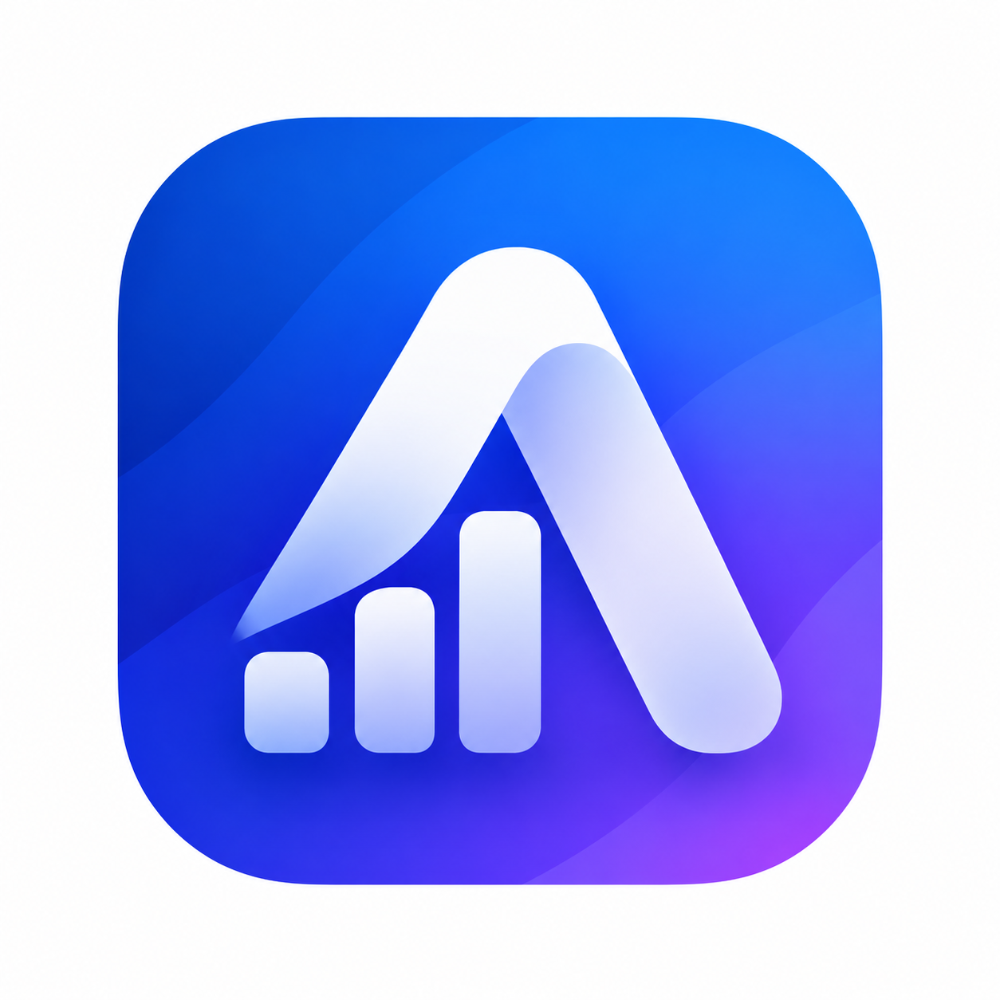

<p align="center">
  
</p>

<h1 align="center">AdSight</h1>
<p align="center"><strong>AI Assistant for Advertising Data Analytics</strong></p>
<p align="center">Connect advertising data, compare performance, and understand what changed.</p>

## Use the hosted app

[Open AdSight](https://adsight.companionablegranola8.chatgpt.site) and sign in with an approved ChatGPT account. Paste a Lark spreadsheet link or token, select a worksheet, and review the column settings to open the dashboard. Hosted users do not need to install anything or provide an API key.

## Product walkthrough

The screenshots use the same example dataset. Click any preview to open the full-size image.

### 1. Connect data and review column settings

Choose a Lark worksheet and review the AI-suggested column labels, roles, and currencies before applying them. Reuse approved settings when you reconnect.

<a href="docs/images/data-setup.jpg"></a>

### 2. Explore a metric in the dashboard

Choose a period, grouping, and targets, then select a metric card to see its trend and target-level values. Clicking a target bar highlights its corresponding trend without changing the query filters.

<a href="docs/images/dashboard.jpg"></a>

### 3. Compare multiple metrics across targets

Select the metrics to compare in one table. Column headings support sorting; values, bars, and ranks are interpreted **within the same metric**, rather than across different units.

<a href="docs/images/metric-comparison.jpg"></a>

### 4. Inspect changes and request an AI explanation

Set analysis and reference periods plus increase/decrease thresholds. Rule-based checks compare each target's metric averages and flag changes or insufficient data. Select a result to inspect the chart, then request an AI explanation of the evidence, limitations, and follow-up checks.

<a href="docs/images/anomaly-analysis.jpg"></a>

Additional tools include original-currency/KRW display using daily reference exchange rates, visualization image copy/export, and shared feedback tracking.

## Run locally

Run your own instance with Python 3.11 and FastAPI. You’ll need Conda and a Lark app with Sheets read permission and access to the target document. Connecting a Wiki link also requires Wiki node read permission.

```sh
git clone https://github.com/janghyunnoh/AdSight.git
cd AdSight
conda env create -f environment.yml
conda activate adsight
cp .env.example .env
```

Enter `LARK_APP_ID` and `LARK_APP_SECRET` in `.env`. Add `NVIDIA_API_KEY` to enable AI column suggestions and finding explanations. See [`.env.example`](.env.example) for optional settings.

```sh
python -m uvicorn app.main:app --host 127.0.0.1 --port 8000 --reload --no-access-log
```

Open [http://127.0.0.1:8000](http://127.0.0.1:8000). The local app stores settings and feedback in SQLite and records document identifiers in a local connection log. Keep `.env` and the local data directory out of Git.

## Data and AI

AdSight reads source spreadsheets without modifying them. AI column suggestions use up to 10 example values per column and any context you provide. AI finding explanations use calculated metrics and supporting evidence. Review suggestions before applying them, and check the evidence before drawing conclusions about causes.

## Tests

```sh
python -m unittest discover -s tests -q
node --test tests/test_*.cjs
```
